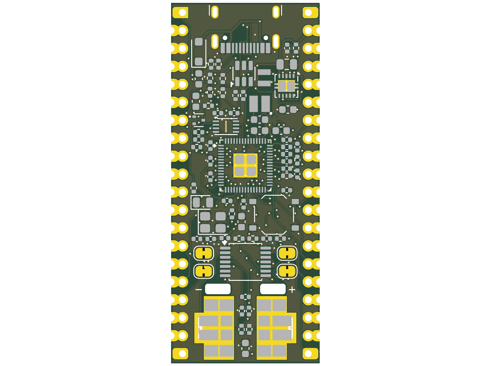
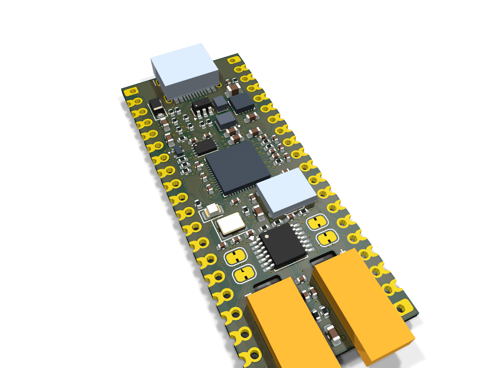

<!-- SPDX-License-Identifier: CERN-OHL-P-2.0 -->
<!-- Copyright 2026 The OhmAI contributors -->
# 🌡️ pico-k — RP2350A + MAX31856 Type-K Thermocouple Board

**A 51 × 21 mm Raspberry Pi Pico 2 drop-in board with an integrated 19-bit Type-K thermocouple front end — built end-to-end as the v0.1 dogfood showcase for [OhmAI](https://github.com/ohmai-pcb/ohmai).**

[](https://github.com/ohmai-pcb/ohmai)
[](LICENSE)
[](hardware/)
[](#project-status--honest-assessment)
[](#project-status--honest-assessment)

[**Honest Assessment & Grades**](#project-status--honest-assessment) · [**Design effort / AI usage (estimate)**](#design-effort--ai-usage-estimate) · [**Key Specifications**](#key-specifications-verified-against-bombomcsv) · [**On-Board Pin Map**](#on-board-pin-map-rp2350a-verified-against-hardwaregenpinmapyaml) · [**Repo Map & Checks**](#repository-map--running-checks) · [**Exceptions & Waivers**](#exceptions-and-waivers)

| 2D Routed Layout (`docs/layout/routed-2d.png`) | 3D Rendered Board (`docs/layout/routed-3d.png`) |
|---|---|
|  |  |

**Designed with [OhmAI](https://github.com/ohmai-pcb/ohmai).** Rev-A design, pre-fab: ERC and DRC are clean; the board has not been fabricated yet.

---

### What is `pico-k`?

`pico-k` is an open hardware reference project and the **v0.1 dogfood testbed** built to stress-test [OhmAI](https://github.com/ohmai-pcb/ohmai)'s 12-phase hardware engineering workflow, datasheet citation checks, 3-rule BOM sourcing, and independent review gates.

Every artifact in this repository — from requirements (`docs/requirements.md`), safety/compliance analysis (`docs/safety.md`), and page-cited component constraints (`parts/constraints/*.yaml`) to the 6-sheet hierarchical KiCad 9 schematic (`hardware/*.kicad_sch`), 4-layer routed PCB (`hardware/pico-k.kicad_pcb`), multi-source BOM (`bom/bom.csv`), and pre-board bring-up self-test (`test/firmware/bringup_selftest.py`) — was generated and verified through `ohmai` with a human owner reviewing and signing off at each gate.

### ✨ Hardware Highlights

- 🧠 **Raspberry Pi Pico 2 Core (`RP2350A`)** — Dual Cortex-M33 / Hazard3 MCU (`U1`, QFN-60 7×7 mm), **Winbond `W25Q32RVXHJQ`** 4 MB QSPI flash (`U2`, XSON-8 2×3 mm), **Abracon `ABM8-272-T3`** 12 MHz crystal (`Y1`), and internal 1.1 V DVDD buck inductor **MPS `MPL-AT2512-3R3`** (`L1`, 3.3 µH) following the *Hardware Design with RP2350* reference circuit.
- 🌡️ **19-Bit Cold-Junction-Compensated Type-K Front End (`MAX31856MUD+T`)** — Analog Devices `MAX31856` (`U5`, TSSOP-14) on `SPI1` (`GP12`–`GP15` via cuttable jumpers `JP1`–`JP4`; `DRDY` and `FAULT` on `TP11`/`TP12`), paired with top-mounted **Omega `PCC-SMD`** miniature flat-pin Type-K socket clips (`J2`, `J3`) and a differential/common-mode RC input filter (`R12`/`R13` 100 Ω, `C25`/`C26` 10 nF X7R, `C14` 100 nF X7R).
- ⚡ **Buck-Boost 3.3 V Power & Protected USB-C** — **TI `TPS63001DRCR`** (`U3`, VSON-10 3×3 mm) 3.3 V buck-boost regulator with **Murata `DFE201612P-2R2M`** 2.2 µH inductor (`L2`, 2016), 16-pin USB-C receptacle (`J1`), **STMicro `USBLC6-2SC6`** ESD array (`U4`, SOT-23-6), and **onsemi `MBR120VLSFT1G`** (`D1`, SOD-123FL) `VBUS`→`VSYS` Schottky diode.
- 📏 **Drop-In 51 × 21 mm Form Factor with Flat Bottom (`R-02`, `R-07`)** — 4-layer 1.0 mm FR-4 stackup (`F.Cu` / `In1.Cu` solid GND / `In2.Cu` 3V3 / `B.Cu`), single-sided top SMD assembly (`66` fitted parts across `36` BOM rows), and 40-pin Pico-compatible edge pinout (`J4`).

---

## Project Status & Honest Assessment

| Dimension | Grade | Honest Commentary |
|---|---|---|
| **1. End-to-End Autonomy** | **5.5 / 10** | **Human-steered, not hands-off, and not yet physically built.** The workflow produced a complete, rule-checked package from Phase 1 (`requirements`) through Phase 11 (`out/fab/rev-A/`) and Phase 12 pre-board preparation (`test/bringup-plan.md`, `test/firmware/bringup_selftest.py`, `docs/manual.md`). However, getting there required substantial human owner steering, course corrections, and tool fixes along the way (`D-001`–`D-030`, `docs/layout/retro.md`), and the board has **not yet been ordered or bench-tested** (`review:fab` and `review:bringup` remain open). |
| **2. Engineering Complexity / Skill Level** | **4.5 / 10** | **Reference-application complexity.** Electrically, this is a straightforward modification of a Raspberry Pi Pico 2 reference design combining three application circuits (`RP2350A` core, `TPS63001` buck-boost, and `MAX31856` SPI thermocouple front end) — low-to-moderate difficulty for an electronics engineer. Where the workflow added genuine rigor was in quantitative verification (exact datasheet page citations, DC-bias derating math, thermal/loop checks, and verified multi-source BOM alternates). |
| **3. PCB Routing & Layout Quality** | **5.0 / 10** | **DRC-clean (`0` violations, `0` unconnected), but visibly machine-routed.** Fitting 66 top-side SMD parts (including two large `PCC-SMD` thermocouple clips `J2`/`J3`) into 51 × 21 mm via `Freerouting` + scripted pass-completion (`hardware/gen/pcb/handroute.py`) produced meandering autorouter traces rather than clean human layout artistry. Closing the board required owner waivers for 25 short signal hops on the `In2.Cu` (`3V3`) plane (`D-020`/`D-023`, pour remains 1 piece with a 0.91 mm minimum neck), downsizing `C18`/`C27` to `0402` (`D-025`), and accepting stretched decoupler placement (`3.2–11.8 mm`) on several `RP2350A` supplies (`D-030`). Every compromise is listed in [Exceptions and waivers](#exceptions-and-waivers). |

---

## Key Specifications (Verified against `bom/bom.csv`)

| Subsystem | RefDes & MPNs (`bom/bom.csv`) | Reference / Decision |
|---|---|---|
| **MCU & Memory** | `U1` Raspberry Pi `RP2350A` (QFN-60 7×7, `C42411118`), `L1` MPS `MPL-AT2512-3R3` (3.3 µH DVDD buck inductor, `C3224274`), `U2` Winbond `W25Q32RVXHJQ` (4 MB QSPI flash, XSON-8 2×3, `C32246052`), `Y1` Abracon `ABM8-272-T3` (12 MHz crystal, SMD3225-4P, `C20625731`) with `C23`/`C24` 15 pF C0G (`C1548`) & `R3` 1 kΩ (`C11702`) | [`parts/constraints/RP2350A.yaml`](parts/constraints/RP2350A.yaml), `D-001`, `D-006`, `D-009` |
| **Thermocouple Front End** | `U5` Analog Devices `MAX31856MUD+T` (TSSOP-14, `C2653162`), `J2`/`J3` Omega `PCC-SMD` (2 × SMT flat-pin socket clips), `R12`/`R13` 100 Ω series (`0402WGF1000TCE`, `C25076`), `C25`/`C26` 10 nF 50 V X7R CM (`CL05B103KB5NNNC`, `C15195`), `C14` 100 nF 16 V X7R diff (`CL05B104KO5NNNC`, `C1525`), `C12`/`C13` 100 nF `AVDD`/`DVDD` decouplers | [`parts/constraints/MAX31856MUD+T.yaml`](parts/constraints/MAX31856MUD+T.yaml), `R-03`, `R-04`, `R-07`, `D-001`, `D-004` |
| **Power & USB Stage** | `U3` TI `TPS63001DRCR` (3.3 V buck-boost, VSON-10 3×3, `C28060`), `L2` Murata `DFE201612P-2R2M` (2.2 µH, 2016, `C79317`), `C20` Samsung `CL21A106KAYNNNE` (10 µF 25 V X5R, 0805, `C15850`), `C21`/`C22`/`C31` 3 × 10 µF 25 V X5R (`CL10A106MA8NRNC`, 0603, `C96446`), `J1` SHOU HAN `TYPE-C 16PIN 2MD(073)` (`C2765186`), `U4` STMicro `USBLC6-2SC6` (SOT-23-6 USB ESD, `C7519`), `D1` onsemi `MBR120VLSFT1G` (SOD-123FL Schottky, `C223608`) | [`parts/constraints/TPS63001DRCR.yaml`](parts/constraints/TPS63001DRCR.yaml), `D-004`, `D-006`, `D-030` |
| **Housekeeping & UI** | `SW1` XKB `TS-1187A-B-A-B` (`BOOTSEL` button, SMD 5.1×5.1, `C318884`) via `R4` 1 kΩ, `D2` KENTO `KT-0805G` (0805 green LED on `GP25`, `C2297`) via `R22` 470 Ω (`C25117`), `Q1` Diodes Inc. `DMG1012T-7` (SOT-523 N-MOSFET on `VSYS_SENSE`, `C20512`) with `R19` 20 kΩ / `R9` 10 kΩ divider | [`hardware/led_boot_adc.kicad_sch`](hardware/led_boot_adc.kicad_sch), `D-006`, `D-007` |
| **PCB Stackup & Form Factor** | **51.0 × 21.0 mm** (`R-02`), 4-layer 1.0 mm FR-4 (`F.Cu` / `In1.Cu` solid GND / `In2.Cu` 3V3 / `B.Cu`), ENIG (JLCPCB `JLC04101H-7628`), top-side SMD assembly (`R-07`), EU target market (`D-003`) | [`docs/requirements.md`](docs/requirements.md), `D-003`, `D-006`, `D-017` |

---

## On-Board Pin Map (`RP2350A`, verified against `hardware/gen/pinmap.yaml`)

| Signal / GPIO | Pin / Net Routing (`pinmap.yaml`) | On-Board Function |
|---|---|---|
| `GP12` (`SPI1_RX`) | `U1.16` / `J4.16` / `JP1` → `U5.11` (`TC_SDO`) | `MAX31856` `SDO` (SPI1 MISO via cuttable jumper `JP1`) |
| `GP13` (`SPI1_CSn`) | `U1.17` / `J4.17` / `JP2` → `U5.9` (`TC_CS`) | `MAX31856` `CS` (SPI1 CSN via `JP2`, 10 kΩ pull-up `R7` to `3V3`) |
| `GP14` (`SPI1_SCK`) | `U1.18` / `J4.19` / `JP3` → `U5.10` (`TC_SCK`) | `MAX31856` `SCLK` (SPI1 SCK via `JP3`) |
| `GP15` (`SPI1_TX`) | `U1.19` / `J4.20` / `JP4` → `U5.12` (`TC_SDI`) | `MAX31856` `SDI` (SPI1 MOSI via `JP4`) |
| `TC_DRDY` | `U5.7` / `TP11.1` (DNF 10 kΩ pull-up `R23`) | `MAX31856` active-low data-ready test pad `TP11` (optional jumper to `GP6`) |
| `TC_FAULT` | `U5.13` / `TP12.1` (DNF 10 kΩ pull-up `R24`) | `MAX31856` active-low fault test pad `TP12` (optional jumper to `GP7`) |
| `GP23` (`SMPS_PS`) | `U1.35` / `TP4.1` / `U3.7` (100 kΩ pull-down `R16`) | `TPS63001` `PS/SYNC` power-save mode control (`LOW` = PFM, `HIGH` = PWM) |
| `GP24` (`VBUS_SENSE`) | `U1.36` (`R18` 5.6 kΩ / `R8` 10 kΩ divider) | USB `VBUS` presence sense |
| `GP25` | `U1.37` / `R22.1` / `D2` / `TP5.1` | User green LED `D2` (`KT-0805G`) active-high via `R22` (470 Ω) |
| `GP29` (`ADC3`) | `U1.43` (`VSYS_SENSE`) | `VSYS` ÷ 3 sense via `Q1` (`DMG1012T-7` N-MOSFET) + `R19` 20 kΩ / `R9` 10 kΩ |
| `BOOTSEL` | `SW1.1` / `TP6.1` / `U2.1` (`QSPI_SS` via `R4` 1 kΩ) | `BOOTSEL` tactile switch `SW1` (`TS-1187A-B-A-B`) active-low on `QSPI_SS` |
| `3V3_EN` / `RUN` | `J4.37` (`U3.6`, `R15` 100 kΩ to `VSYS`) / `J4.30` (`U1.26`) | `TPS63001` enable and `RP2350A` active-low hardware reset |

---

## Repository Map & Running Checks

- **Project status & logs:** [`STATUS.md`](STATUS.md), [`docs/decisions.md`](docs/decisions.md), [`docs/layout/retro.md`](docs/layout/retro.md)
- **Specs & compliance:** [`docs/requirements.md`](docs/requirements.md), [`docs/architecture.md`](docs/architecture.md), [`docs/safety.md`](docs/safety.md), [`docs/manual.md`](docs/manual.md)
- **Parts, constraints & datasheets:** [`parts/selection.md`](parts/selection.md), [`parts/constraints/`](parts/constraints/), [`datasheets/manifest.yaml`](datasheets/manifest.yaml), [`bom/bom.csv`](bom/bom.csv)
- **KiCad design & generators:** [`hardware/`](hardware/) (`pico-k.kicad_pro`, root `pico-k.kicad_sch` + 6 hierarchical subsheets `power_usb`, `regulator`, `mcu_core`, `thermocouple`, `led_boot_adc`, `edge`, `pico-k.kicad_pcb`, `hardware/gen/`)
- **Reviews & bring-up:** [`reviews/`](reviews/), [`test/bringup-plan.md`](test/bringup-plan.md), [`test/firmware/bringup_selftest.py`](test/firmware/bringup_selftest.py)

```bash
pip install -e <ohmai-checkout>/cli
ohmai status
ohmai datasheets fetch && ohmai datasheets check
ohmai check constraints --gate
ohmai check schematic --gate
ohmai check layout --gate
ohmai check bom --gate
```

## Exceptions and waivers

These are pico-k-only decisions by the owner. They are **not OhmAI defaults**: the OhmAI template, skill and
gate configuration are unchanged, and another project starts without any of them. Details and reasons are in
[`docs/decisions.md`](docs/decisions.md) under each ID.

- **D-009 – L1 inductor deviation.** L1 is an MPL-AT2512-3R3, not the RP2350 reference inductor. This is a
  documented rev-A deviation. Both orientations are built, and the external 1.1 V DVDD supply stays possible as a
  fallback (JP5/JP6 solder jumpers, feed into TP7).
- **D-010 – USB inrush deviation.** At attach, pico-k draws more charge from VBUS than USB 2.0 allows, and C19
  alone is above the USB capacitance limit. This is accepted for rev-A, with a VBUS droop test in bring-up and a load
  switch plan for rev-B if it fails. No USB compliance claim or USB logo while this stands.
- **D-016 – Schematic review independence waiver.** For the schematic gate, the owner accepted Reviewer-A as the
  reviewer at independence level 3 instead of the configured level 2, for that gate and that files_hash only.
- **D-017 – Mechanical deviations from the Pico 2.** No mounting holes. The four end pins (1, 20, 21, 40) keep
  their positions but have no castellated half-hole, because JLC's castellation edge rules can't be met there in
  the Pico 2 outline. When the board is soldered flat onto a carrier, those four joints can't be inspected.
  Also accepted: the PCC-SMD slot non-plated, the clip tab depth on a 1.0 mm board (fit checked at bring-up), the
  test-point mapping, and the small layout deviations listed under P8-6.
- **D-020 + D-023 – Signals on the In2 (3V3) plane layer.** Normally In2 is a solid 3V3 plane. Here, signals may
  run on In2, including longer runs (D-023). The rules: the 3V3 pour stays one connected piece, pour necks are at
  least 0.5 mm wide (at least 0.8 mm near U1 and the decouplers), In1 (GND) stays solid with no signals, and USB,
  GND and 3V3 never route as tracks on In2.
- **D-021 – Placement rework around U1, and JP5/JP6 on the bottom.** The placement around the RP2350 was reworked
  for escape channels (flash moved, decoupler columns spaced out). JP5/JP6 are bare-copper solder jumpers on the
  bottom side. That needs the owner's reading of R-07 (bottom flat, no parts), and is accepted for now unless the
  owner objects (D-022).
- **D-022 – Scripted hand-routing.** The connections the autorouter left open are routed by a scripted,
  replayable step on top of a frozen autorouter result, instead of by the autorouter alone.
- **D-024 / D-025 – Right passive column shift and a BOM change.** The cap/resistor column right of U1 moved about
  0.5 mm outward. To make room, C18 and C27 changed from 0603 (`CL10A475KO8NNNC`) to 0402 4.7 µF 25 V X5R parts (Taiyo Yuden `TDK105CBJ475MV-F`, LCSC `C22385335`, JLC extended — note: `TDK105CBJ475MV-F` is Taiyo Yuden's actual MPN per `bom/bom.csv` and `datasheets/TDK105CBJ475MV-F.pdf`, where `T` = 25 V, `DK` = series code, `105` = 1005 metric / 0402).
  At 3.3 V their effective capacitance is about 16 % lower than the 0603's (about 2.7 µF typical instead of 3.2 µF,
  DC-bias derating). The owner accepted that and the extended-part fee.
- **D-026 – Q1 placement and the last links.** Q1 could not move next to U1 (no room). It stays on the west edge,
  with R19/R9 moved next to it (electrically identical). VSYS_SENSE and VBUS_SENSE are therefore long hand routes.
  Two silkscreen overlaps were cleared by small part nudges instead of waivers.
- **D-027 – DVDD decoupler placement.** C9 sits directly under U1 pin 23 (DVDD) with a short trace and no via. C28
  moved down to make room. The crystal parts stay where they were.
- **D-028 – Layout review independence waiver.** For the layout gate, the owner accepted Reviewer-A as the reviewer at
  independence level 3 instead of level 2, for that gate and the reviewed `files_hash` values (`c71de844…` and D-030 `a0379e72…`) only. A level 1/2 cloud reviewer was
  possible, but the owner chose Reviewer-A.
- **D-029 – TPS63001 input capacitor deferral (superseded by D-030).** With the pre-D-030 3015 inductor and 1206 C20, four placement/reroute attempts could not move C20 to U3 VIN and close routing at 51 × 21 mm; superseded by D-030, which resolves L1 on the 51 × 21 mm board. The approved In2 exceptions (VBUS_SENSE hop, SMPS_PS stub) were not needed and are not used on the board.
- **D-030 – BOM and layout rework for TPS63001 and ADC_AVDD at 51 × 21 mm.** L2 changed to Murata DFE201612P-2R2M (2016, JLC extended part C79317, custom footprint `pico-k:L_Murata_DFE201612P` with an all-layer under-coil keepout), C20 changed to Samsung CL21A106KAYNNNE (0805 10 µF 25 V X5R, ~5.8 µF typical / ~5.0 µF worst-case at 5 V ≥ 4.7 µF SLVS520C minimum), and C32 (100 nF 0402 CL05B104KO5NNNC) was added on ADC_AVDD at U1 pin 44 alongside C27. On the routed 51 × 21 mm board (`5d80779`, 0 DRC violations, 0 unconnected items), C20.1 reaches U3.5 [VIN] in 1.65 mm center-to-center (0.62 mm pad-edge gap, 1.55 mm routed on F.Cu at 0.30 mm width with 0 vias), resolving Reviewer-A L1; L2 has zero copper across all layers in its under-coil keepout and 0.25 mm switch traces (resolving L6 and L13); C32 decouples U1.44 (resolving L5 and Q3). The In2.Cu 3V3 pour remains 1 piece (772.70 mm², narrowest neck 0.91 mm), In1.Cu has 0 signal tracks, and only short signal hops (`DVDD`, `/ADC_AVDD`, `/ADC_VREF`, `/GP8`–`/GP10`, `/GP12`–`/GP14`, `/GP18`–`/GP22`, `/GP25`, `/QSPI_SD1`, `/QSPI_SD2`, `/QSPI_SS`, `/VSYS_SENSE`, `Net-(D1-A)`, `Net-(J4-Pad30)`) use In2.Cu under D-020/D-023 (neither the VBUS_SENSE In2 hop nor the SMPS_PS In2 stub was used). The remaining 51 × 21 mm placement/density trade-offs (Reviewer-A L2–L4 and L7–L12) were accepted by the owner in `reviews/layout/resolutions.md`.

---

## Design effort / AI usage (estimate)

Figures below are an **estimate** of AI-agent design effort from the project's commit log and recorded decisions. They are not billed usage, and request or token counts are not available for the full design period. Toolchain development that was not specific to this board is excluded.

| | |
|---|---|
| Wall-clock span | 15–26 October 2026 (12 calendar days) |
| Active days | 7 days with commits (6 in the pre-publication history, plus a documentation commit on 26 October). No commits 18–22 October. |
| Agent sessions | 10 (9 design sessions in the pre-publication history, plus the 26 October documentation commit) |
| Git commits | 182 in the pre-publication history (176 non-merge); later condensed to 2 commits on the published default branch |
| Approximate usage | About 33 hours of elapsed time across the 9 design sessions (35 distinct hours that contain a commit), plus one later documentation commit. Lower bound. |
| Human decisions | 31 recorded design decisions (D-000–D-030), plus independent reviews of constraints, schematic, layout (2 rounds), and BOM (2 rounds) |

Freerouting 2.1.0 and 2.2.4 were used; after those runs plateaued, remaining nets were finished with a scripted hand-router. In the pre-publication history, 13 commits mention Freerouting and 33 mention hand routing.

Method: a session is a cluster of commits with no gap longer than 3 hours. Session hours are the elapsed time from the first to the last commit in each cluster. That is a lower bound: it omits agent work that left no commit, and the independent reviewer's time. Chat-turn and token totals were not available for the whole design period.

---

## License

pico-k is licensed under the CERN Open Hardware Licence Version 2 - Permissive (CERN-OHL-P-2.0). See [LICENSE](LICENSE) and [NOTICE](NOTICE).

The [OhmAI](https://github.com/ohmai-pcb/ohmai) tool used to design this board remains licensed under Apache-2.0.

Designed with [OhmAI](https://github.com/ohmai-pcb/ohmai).
