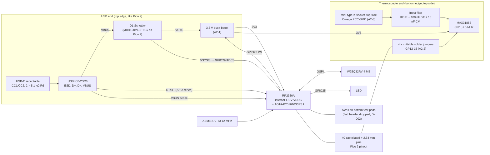

# Architecture: pico-k

> **Status: APPROVED by the owner 2026-10-15 (D-004: A2-3 = M1 Omega PCC-SMD with F1; other recommendations accepted).** Requirements locked (D-001, amended by D-002
> SWD header dropped and D-003 EU market only). Each
> section ends with the recommendation; the owner's picks are recorded in D-004 (`docs/decisions.md`). Page numbers are printed page numbers. `ESTIMATE:` marks numbers not taken from a source.
> Prices are LCSC unit prices in USD read 2026-10-15 unless stated otherwise.

## Block diagram

## Options compared
The locked requirements fix the MCU (RP2350A), the TC IC (MAX31856), the outline and the pinout, so the
only topology-level choice is the 3.3 V regulator. The other real choices are separate trade tables
below (pins, connector, USB-C part, layers, grounded probes).

### A2-1: 3.3 V regulator (VSYS → 3V3)
| Criterion (from requirements) | A: TPS63001DRCR buck-boost | B: RT6150B-33GQW buck-boost (exact Pico 2 part) | C: AP2112K-3.3TRG1 LDO |
|-------------------------------|----------|----------|----------|
| Meets all musts? | Yes | Yes | Yes for R-06 (USB 5 V only), but see the next row |
| Keeps Pico 2 VSYS behaviour (1.8 to 5.5 V) (W-03) | Yes, VIN 1.8–5.5 V (LCSC C28060) | Yes, VIN 1.8–5.5 V (Pico 2 datasheet §5.4 p.15) | No: needs VSYS ≥ 3.3 V + dropout (125 mV typ / 200 mV max at 300 mA; AP2112 datasheet DS39724 p.7) |
| 3V3 user load < 300 mA as on Pico 2 (R-04) | Yes, 1.2 A in step-down mode (LCSC C28060) | Yes, 800 mA (LCSC C3187669) | Thermally no: see Thermal (Tj ≈ 157 °C at 70 °C ambient, 352 mA) |
| PS pin driven by GPIO23 like Pico 2 | Yes: PS/SYNC "1 disabled, 0 enabled" power save (TI SLVS520C p.3), same polarity as RT6150 PS | Yes (Pico 2 datasheet §5.4) | No PS pin; GPIO23 left unconnected |
| Efficiency / losses at 352 mA out | ESTIMATE: ~88 % → 0.16 W (TI lists "up to 96 %") | ESTIMATE: ~88 % → 0.16 W (RT6150 datasheet p.7 curves read ~90–93 % at 100–500 mA, VIN 4.2–5.5 V) | (4.65 − 3.3) V × 0.352 A = 0.48 W |
| Noise near the thermocouple | Switching at 1.5 MHz (LCSC C28060); keep at USB end | Switching 0.8–1.2 MHz (LCSC C3187669); keep at USB end | Best (no switching), but its heat is the bigger problem |
| BOM cost (regulator only, qty 10) | ESTIMATE: $1.62 @1 (search snippet of LCSC C28060; price not shown on the fetched page) + 2.2 µH inductor | $3.2278 @10 (LCSC C3187669, reference price) + 2.2 µH inductor | Price not shown on LCSC page C51118 |
| Part count / board area | IC 3 × 3 mm VSON-10 + L + caps | IC 2.5 × 2.5 mm WDFN-10 + L + caps | SOT-25 + 2 caps (smallest) |
| Risk | Not the Pico 2 part: new layout, from TI app circuit | Copy of Pico 2 schematic | Thermal shutdown with user loads; changes VSYS behaviour |
| Sourcing | LCSC C28060 **in stock, 10,145** | LCSC C3187669 **out of stock**; DigiKey 605 and Farnell 436 listed via OMO aggregator (2026-10-15) | LCSC C51118 in stock, 11,860 |

**Recommendation A2-1: A (TPS63001DRCR).** It keeps the full Pico 2 power behaviour (VSYS 1.8–5.5 V,
3V3_EN, GPIO23 power-save control, 300 mA user load), has the same PS polarity as the Pico 2 part, and is
in stock at LCSC for JLCPCB assembly. B is the exact Pico 2 part, but it is out of stock at LCSC today.
C fails the 300 mA user-load case thermally.

## Power tree and budget
Pico 2 power chain kept (Pico 2 datasheet §5.4–5.5 p.15): VBUS → D1 Schottky → VSYS → 3.3 V regulator →
3V3. VBUS stays on pin 40 and VSYS on pin 39. 3V3_EN (pin 37) goes to the regulator EN pin, 100 kΩ pull-up
to VSYS. GPIO24 = VBUS sense (divider), GPIO29/ADC3 = VSYS/3, GPIO23 = regulator power-save pin.
USB 5 V is the only supported source (R-06). An external VSYS source still works electrically with
option A or B (W-03); that is not tested for D-001.

| Rail | Source | V nom (min..max) | I typ / max | Load(s) | Loss (W) | Source of numbers |
|------|--------|------------------|-------------|---------|----------|-------------------|
| VBUS | USB-C host or powerbank | 5.0 (4.5..5.5) V | ESTIMATE 13.7 mA / 0.28 A + user VBUS load | D1, ESD, VBUS pin 40 | - | VBUS 5 V ± 10 %: Pico 2 datasheet §3.3 p.12; typ: Pico 2 Table 2 p.13 "Hello_usb" 12.74 mA + MAX31856 |
| VSYS | VBUS via D1 (MBR120VLSFT1G as on Pico 2) | VBUS − diode drop; ESTIMATE 4.65 V at 5.0 V in | ≈ VBUS current | regulator, VSYS/3 divider, VSYS pin 39 | ESTIMATE: 0.35 V × 0.28 A = 0.10 W (max) | diode drop: ESTIMATE (diode datasheet to be read in phase 4) |
| 3V3 | regulator (A2-1) | 3.3 V | ESTIMATE: 15 mA / 352 mA | RP2350A + flash + LED (ESTIMATE 50 mA max), MAX31856 (1.2 mA typ, 2 mA max), user 3V3 pin (< 300 mA) | A/B: ESTIMATE 0.16 W; C: 0.48 W | MAX31856 IDD: datasheet p.2; 300 mA: Pico 2 datasheet p.9; 50 mA MCU max is an ESTIMATE |
| 1V1 (DVDD) | RP2350 internal switching VREG from 3V3 | 1.1 V | inside the 3V3 figure | RP2350 core | included above | Hardware design with RP2350 §2.1 |
| ADC_AVDD / ADC_VREF | 3V3 via R-C (201 Ω, 2.2 µF) as on Pico 2 | 3.3 V | ~150 µA | RP2350 ADC | ~0 | Pico 2 datasheet §5.3 p.14 |
| MAX31856 AVDD / DVDD | 3V3, 0.1 µF each to AGND / DGND | 3.3 (3.0..3.6) V | 1.2 mA / 2 mA | MAX31856 | 0.007 W max | MAX31856 datasheet p.2, p.10 |

Sum of losses, worst case (352 mA on 3V3, option A): ESTIMATE 0.10 W (D1) + 0.16 W (regulator) = **0.26 W**.
VBUS current worst case ESTIMATE 0.28 A, inside the 0.5 A USB 2.0 default (USB 2.0 specification). The host or powerbank limits any
extra load the user draws from pin 40.

## Bus map
| Bus | Controller | Device | Address / CS | Speed | Pull-ups (where, value) | Voltage domain |
|-----|------------|--------|--------------|-------|-------------------------|----------------|
| SPI1 | RP2350A GP14 SCK, GP15 TX→SDI, GP12 RX←SDO | MAX31856 | CS = GP13, active low | ≤ 5 MHz (MAX31856 fSCL max, datasheet p.5) | CS pull-up to 3V3 on the IC side of the jumper, so the IC stays deselected when the jumper is cut. ESTIMATE value 10 kΩ, phase 4 | 3.3 V |
| QSPI | RP2350A QSPI | W25Q32RV flash | QSPI_SS | as Pico 2 | as Pico 2 / RP2350 minimal design | 3.3 V |
| USB 2.0 FS | RP2350A USB_DP/DM | host via USB-C | - | 12 Mbit/s | none needed (RP2350 has them internally; HW design with RP2350 §5.1 p.15) | 3.3 V PHY, 5 V VBUS |
| SWD | bottom test pads (D-002) | RP2350A | - | - | RP2350 internal ~60 kΩ (Pico 2 datasheet §5.8 p.18) | 3.3 V |
| I2C | none on board | - | - | - | - | No address clashes possible (no on-board I2C devices) |

MAX31856 SDO is high impedance while CS is high (MAX31856 datasheet p.15), so the 4 lines can be shared
with the user's own SPI devices if the jumpers stay closed. DRDY and FAULT go to test pads only. They would
need 2 more GPIO, and firmware can read the fault register (0Fh) and use 1-shot conversion timing instead.

### A2-2: which 4 GPIO for SPI
SPI pin functions per RP2350 datasheet Table 3 (§1.2.3, p.17–18). Defaults: pico-sdk `pico2.h` sets UART0 =
GP0/GP1, I2C0 = GP4/GP5, SPI0 = GP16 RX / GP17 CSn / GP18 SCK / GP19 TX, LED = GP25. MicroPython rp2 sets
SPI1 = GP8 MISO / GP10 SCK / GP11 MOSI and UART1 = GP4/GP5. Sources:
https://github.com/raspberrypi/pico-sdk/blob/master/src/boards/include/boards/pico2.h and
https://github.com/micropython/micropython/blob/master/ports/rp2/machine_spi.c, machine_uart.c (read 2026-10-15).

| Option | Pins (physical) | Clashes with defaults | Other common use lost | Trace length to MAX31856 at the TC end |
|--------|-----------------|-----------------------|-----------------------|----------------------------------------|
| P1: SPI1 on GP12 RX, GP13 CSn, GP14 SCK, GP15 TX | 16, 17, 19, 20 | none of the SDK or MicroPython defaults above | HSTX (RP2350 F0 on GP12–19, e.g. DVI output) and the UART0 alternate pins | shortest: pins 19/20 are the last pins at the end opposite USB |
| P2: SPI1 on GP8 RX, GP9 CSn, GP10 SCK, GP11 TX | 11, 12, 14, 15 | MicroPython default SPI1 bus (shareable, CS GP9 is not a default) | - | mid-board, longer |
| P3: SPI0 on GP16–19 | 21, 22, 24, 25 | pico-sdk default SPI0 including its default CSn (GP17) | HSTX | short (right-hand column, same end) |

**Recommendation A2-2: P1 (GP12–GP15, SPI1).** No clash with any SDK or MicroPython default. Shortest
traces, because pins 16–20 end at the thermocouple end. Users who need HSTX cut the 4 jumpers.

## Thermocouple connection (A2-3) and front end
Owner feedback 2026-10-15: drop the debug header and fit a real mini type-K socket (accepts standard
2-pin mini plugs) on the TOP side at the end opposite USB. Keep the bottom flat for castellated soldering.
Keep the 4 mounting holes and the full castellated rows if possible (requirement change D-002).

### Geometry at the end opposite USB (Pico 2 datasheet Fig. 3, p.7)
Coordinates: x across the board (0 … 21 mm); y = distance from the short edge opposite USB.
- Castellated pads: centres x = 1.61 and 19.39 mm. Last pin pair (20/21) at y = (51 − 48.26)/2 = 1.37 mm,
  then every 2.54 mm. Pad Ø1.6 (Fig. 3), so pad copper reaches x = 2.41 / 18.59.
  Clear width between the rows: **16.18 mm** (17.8 mm with a plain 1.6 mm keep-out per edge).
- Mounting holes: Ø2.1 ± 0.05 mm, 11.4 mm apart, centred → **x = 4.8 and 16.2 mm**, **y = 2.0 mm** from
  the short edge (Fig. 3: "11.4", "2"). Verified: (21 − 11.4)/2 = 4.8. Hole edge reaches y = 3.05 mm.
- SWD header: dropped (D-002). SWCLK/SWDIO/GND go to flat bottom-side test pads like the Pico 2 TP1–TP7
  (copper only, so the bottom stays flat; Pico 2 datasheet §3.1 p.9). That frees the edge centre.

### Candidates (all mini 2-pin, 7.9 mm pin pitch)
| ID | Part (source) | Size / footprint | Contacts | Mounting | Result on 21 mm Pico end |
|----|---------------|------------------|----------|----------|--------------------------|
| M1 | **Omega PCC-SMD** (pair of SMT clips = one jack; PCC-SMD-20 strip / -500 / -1000 reel). https://assets.omega.com/spec/PCC-SMD.pdf p.1–2 | Each clip 11.94 × 5.6 mm, 2.37 mm high, 7.92 mm c-c (p.1). Footprint for the pair, from the board edge: pads x = ±1.60 … ±5.87 mm, y = 0.50 … 9.50 mm; side tabs into plated slots to ±7.21 mm, y 2.84 … 7.16; rear slots y 9.77 … 11.27 (p.2 "Bare PCB") → **14.42 × 11.27 mm** | Ni-plated beryllium copper, "universal calibration"; Omega marks the "ideal cold junction compensation location" right at the clips and says the flat bottom couples them thermally to the board (p.1–2) | SMT reflow, pick and place. Tabs go into slots; Section B-B shows a tab depth of about 1.17 mm below the PCB top (drawn on a 1.6 mm board). On our 1.0 mm board that is **ESTIMATE ≈ 0.17 mm below the bottom**, to confirm with the part | **Fits the width** (x 3.29 … 17.71; 0.88 mm to the pad copper each side) and keeps the bottom flat except the tab tips. **Clashes with both end mounting holes** (see table below). The plug body sits off the board end and hangs below the board plane (p.2 Section A-A), so the clips must be at the board edge |
| M2 | Omega PCC-SMP-K (horizontal jack). https://assets.omega.com/spec/PCC-OST-SMP_spec.pdf p.2 | Body 15.5 wide × 16.0 long, 20.8 mm with the contact tabs, 8.6 mm high; 4 × Ø1.77 mm holes for the 2 contact tabs (7.9 mm apart) and 2 bracket legs. The bracket legs read as 15.7 mm apart (bracket wraps the 15.5 mm body). That reading is mine, to confirm with Omega | Type-K alloy (K calibration) | Through-hole contacts and bracket legs; the bracket "must be used" | Bracket holes at x ≈ 2.65 / 18.35 overlap the castellated pad copper (to x = 2.41 / 18.59) at any y. Body covers both end holes. Through-hole legs break the flat bottom → **does not fit** |
| M3 | Omega PCC-SMP-K-R (same jack with TO-92 retainer clip); PCC-SMP-K-100 is the same part in a 100-pack | as M2 | as M2 | as M2 | as M2 |
| M4 | Labfacility AM-K-PCB / XE-1139-001 (Farnell 234-7140). https://static.rapidonline.com/pdf/61-3068.pdf | Body 16.25 long × 16.6 wide; 2 solid Ø1.3 mm pins at 7.9 mm pitch; height not given | "True thermocouple alloys" (NiCr / NiAl), CJ sensor provision, 220 °C | Through-hole pins | Pins clear the castellations (x ≈ 6.55 / 14.45). Body 0.21 mm wider than the clear width on each side; covers both end holes if at the edge; through-hole pins break the flat bottom → **does not fit** without trimming and losing 2 holes |
| M5 | Thermosense FCB1-K / FCB2-K / FCB3-K (flat / rear / side). https://www.thermosensedirect.com/media/thermoattachment/products/attachments/thermosense_datasheet_058.pdf (search snippet; PDF download returned HTML) | 16 × 25.4 × 8 mm overall | TC-alloy pins; brass screws (FCB1) or copper pins (FCB2/3) to the PCB | Through-hole / screw | Too long and through-hole → **does not fit** |
| M6 | TC Ltd F21 / F23 / F38 (bottom / rear / side PCB sockets). https://www.tc.co.uk/thermocouple_connectors/mini_pcb_connectors.html | Dimensions not published on the page | TC alloys | PCB | Not assessable |

No SMD mini socket with TC-alloy contacts was found. **Thermocouple-alloy contacts are not needed with M1:**
the cold junction is where the plug's K-alloy blades meet the clips. The MAX31856 measures there if it sits
next to the clips at the same temperature (MAX31856 datasheet "MAX31856 Location" p.28; Omega PCC-SMD p.1–2).
Alloy contacts matter only when the IC is far from the connector.

### M1 (PCC-SMD) vs the end mounting holes
| Item | PCC-SMD (clips at the edge) | Mounting hole (x, y, Ø) | Result |
|------|-----------------------------|-------------------------|--------|
| Left clip pad | x 4.63 … 8.90, y 0.50 … 9.50 | (4.8, 2.0, Ø2.1): x 3.75 … 5.85, y 0.95 … 3.05 | **Overlap 1.22 mm in x**, pad over the drill |
| Left side tab slot | x 3.29 … 3.80, y 2.84 … 7.16 | same hole | 0.26 mm drill-to-slot. **Fails** with any annular ring / clearance |
| Right clip pad / tab | mirror | (16.2, 2.0, Ø2.1) | mirror, **fails** |
| Clip pad vs castellated pads (20/21 … 15/26) | x 3.29 … 17.71 | pad copper to x 2.41 / 18.59 | **0.88 mm clear**, OK |
| Clips moved inboard to clear the holes (pads from y ≥ 3.35) | plug body would then sit over the board and hang below its plane (p.2 Section A-A) | - | not possible on a 1-piece board |

**Does it fit inside 51 × 21 mm with all 4 holes? No.** The only part that keeps the bottom flat and the
castellated rows (M1) needs the 14.42 × 11.27 mm strip at the board edge, where both end holes are.

### Least-bad options (owner chose F1, D-004)
| Option | What changes | Keeps | Loses / risk |
|--------|--------------|-------|--------------|
| **F1: drop the 2 end mounting holes** (M1 at the 51 mm edge) | Holes at (4.8, 2.0) and (16.2, 2.0) removed; the 2 holes at the USB end stay | 51 × 21 outline, all 40 castellated / 2.54 mm pins, flat bottom (except ≈0.17 mm tab tips, ESTIMATE) | Only 2 holes for screws. Plug hangs below the board plane beyond the end, so a carrier board must stop at the module end (or have a cut-out there) |
| **F2: overhang tongue** (M1 on a PCB extension beyond 51 mm) | Outline 51 → ESTIMATE ≈ 63.3 mm (tongue 12.3 × 15.4 mm, x 2.8 … 18.2) | All 4 holes in the Pico positions, all 40 pins, flat bottom (except tab tips) | Breaks R-02 (51 × 21). Longer than a Pico in an enclosure / socket. The tongue must overhang the carrier edge |
| F3: through-hole mini jack (M2/M4) | Trim the leads; covers 2 holes; M2 also collides with the castellations | - | Breaks the flat bottom and the castellated rows. Not recommended |
| F4: no socket (Phoenix PTSM 0,5/2-2,5-V SMD push-in terminal or solder pads, from the first draft) | - | everything | Not a mini-plug socket; does not meet the owner's request |

Sketches (made from the datasheet numbers above; not a footprint): `docs/img/fit-o1-pcc-smd-edge.svg` (F1)
and `docs/img/fit-o2-pcc-smd-tongue.svg` (F2).

**Recommendation A2-3: M1 Omega PCC-SMD, with F1 (drop the 2 end holes) if the 51 × 21 outline matters
more than the holes, or F2 (tongue) if the 4 Pico holes matter more.** The agent leans to F1, because the
outline and the castellated footprint are what make it a drop-in Pico, and 2 holes at the USB end remain.
This is the owner's call.

Open points for phase 4: PCC-SMD price and stock (not on LCSC; Omega/ITM/Novapart list -20, -500, -1000
packs, no price found); real tab depth on a 1.0 mm board; JLCPCB assembly of a consigned part.

### Front end (MAX31856 datasheet "Applications Information" p.27–28)
- **Filter:** 100 nF ceramic differential capacitor across T+/T− ("strongly recommended"). Footprints for
  10 nF T+→GND and T−→GND (for RF), and 100 Ω in series with T+ and T− (Figure 8). Matched series resistors:
  datasheet example gives 3.7 µV offset for 1 Ω mismatch + 50 Ω cable (p.28). ESTIMATE ≈ 0.1 °C for type K.
- **BIAS:** connect BIAS to T− (p.27). Do not ground T− elsewhere.
- **Protection:** inputs protected to ±45 V (p.2). 2 kΩ series resistors (Figure 9) only for faults above
  ±45 V; not proposed, as they add offset (p.28).
- **Decoupling:** 0.1 µF at AVDD and at DVDD (p.10, p.27).
- **Cold junction:** the IC measures its own die temperature, so place it as close as possible to the
  connector and minimise thermal gradients between the connector and the IC (p.28). Plan: MAX31856 directly
  behind the PCC-SMD clips (the 3.2 mm gap between the clip pads is too narrow for TSSOP-14). Short, wide T+/T−
  copper from the clip pads, and a GND pour under the clips and the IC on the inner layer. No other heat source
  at that end of the board.
- **Self-heating:** 2 mA max × 3.3 V × θJA 110 °C/W (p.2) = **ESTIMATE ≤ 0.7 °C** die rise in continuous
  conversion. That is a cold-junction error unless the board area is at the same temperature. Mitigation: 1-shot
  conversions (lower duty), copper spreading, and the CJ offset register (09h, p.12) calibrated at bring-up.
- **Isolation from heat:** regulator, D1, inductors and RP2350 stay at the USB end, as on the Pico 2. A copper
  keep-out "moat" in all layers between the MCU area and the TC area, crossed only by the 4 SPI lines, 3V3
  and one GND bridge. Exact geometry is a layout job (phase 8).

### A2-4: grounded-junction probes and the common-mode range
MAX31856 input common-mode range is 0.5 to 1.4 V; BIAS holds T− at 0.735 V nominal (datasheet p.3, p.10).
The board ground is the USB ground of the laptop or powerbank. A grounded-junction probe touching a
conductive object that is at the same potential as that USB ground (e.g. an earthed object while the laptop
charger earths the laptop) pulls T− towards 0 V, outside the common-mode range. Accuracy is then not
specified. A negative input or one above VDD sets the OVUV fault, and conversions stop (p.26). With a
floating source (powerbank, laptop on battery) or a non-conductive or isolated object, grounded probes work
normally.

| Option | What it takes | Effect on the musts |
|--------|---------------|---------------------|
| G1: accept and document | User note + firmware checks: OVUV/open faults, cold-junction plausibility | R-12 met with a documented limit (earthed object + earthed host) |
| G2: galvanic isolation of the TC front end | Isolated 3.3 V DC/DC + 4-channel digital isolator between RP2350 and MAX31856. No parts selected | Adds parts and area in a 21 mm wide board next to the connector; probably fails R-02 next to the socket; ESTIMATE > $3 BOM |

**Recommendation A2-4: G1.** It is the normal behaviour of non-isolated thermocouple boards. Whichever
option is chosen, the limit is a **required manual warning** (MW-01 in STATUS.md, `docs/manual.md` §Safety).

## USB-C (R-15)
- **CC:** CC1 and CC2 each get their own 5.1 kΩ Rd to GND. Never tie CC1 and CC2 together. USB Type-C spec
  R2.0 Table 4-25 and Figure 4-9 (https://usb.org/sites/default/files/USB%20Type-C%20Spec%20R2.0%20-%20August%202019.pdf);
  see also https://people.kernel.org/bleung/how-to-design-a-proper-usb-c-power-sink-hint-not-the-way-raspberry-pi-4.
  Use 1 % parts. ±10 % is enough to detect the source's current advertisement (Microchip AN1914 Table 1,
  https://ww1.microchip.com/downloads/aemDocuments/documents/OTH/ApplicationNotes/ApplicationNotes/00001914B.pdf),
  and the firmware does not need it.
- **Data:** A6/B6 (D+) and A7/B7 (D−) tied in pairs at the receptacle. 27 Ω series resistors close to
  RP2350. 90 Ω differential: about 0.8 mm tracks, 0.15 mm gap on a 1 mm board, over solid ground (Hardware
  design with RP2350 §5.1 p.15). SBU1/2 not connected.
- **ESD:** ST USBLC6-2SC6 (LCSC C7519, $0.1786 @5, stock 27,200): D+, D− and VBUS, IEC 61000-4-2 level 4,
  3.5 pF max. Placed right at the receptacle.
- **VBUS:** to D1 and to pin 40 (VBUS). VBUS sense to GPIO24 through the Pico 2 divider. Shell to GND.

### A2-5: USB-C receptacle part
| Option | Part | Size | Mounting | Price / stock |
|--------|------|------|----------|---------------|
| U1 | Korean Hroparts TYPE-C-31-M-12 (LCSC C165948) | 8.94 mm wide, 7.35 mm deep (datasheet drawing) | 16 SMD contacts + 4 through-hole shell tabs in plated slots, 2 locating pegs | $0.1879 @5, stock 364,590 |
| U2 | Fully SMD-shell receptacle (e.g. SHOU HAN TYPE-C 16PIN 2MD(073), LCSC C2765186) | 7.35 mm length per LCSC | LCSC: "Surface Mount, Right Angle". Datasheet not read; may need a board cutout ("mid-mount", unverified) | $0.0753 @20, stock 939,020 |

The Pico 2 itself uses a through-hole USB connector whose pins do not come through the board. Solder can
pool on the underside, so the Pico 2 SMT footprint has pads for it (Pico 2 datasheet §3.2 p.10).
**Recommendation A2-5: U1**, with the same approach: shell-tab pads in our published SMT footprint. Before
phase 4, check the tab length against a 1 mm board; if the tabs come through, switch to U2 after reading its
datasheet.

## Thermal
Ambient for the thermal pass: 70 °C, the Pico 2 recommended maximum (Pico 2 datasheet p.12). θJA values
are JEDEC 4-layer test boards. A 51 × 21 mm board will be worse (ESTIMATE ×1.5–2).

| Part | Loss (W) | θJA or board estimate | ΔT | Tj at max ambient | Margin to Tj max | Source |
|------|----------|-----------------------|----|-------------------|------------------|--------|
| TPS63001 (option A) | ESTIMATE 0.16 | 46.8 °C/W | 7.5 °C (ESTIMATE ×2: 15 °C) | 85 °C | 40 °C to 125 °C | TI SLVS520C p.4 |
| RT6150B (option B) | ESTIMATE 0.16 | 40.9 °C/W | 6.5 °C (×2: 13 °C) | 83 °C | 42 °C to 125 °C | RT6150 DS6150A/B-06 p.4 |
| AP2112K SOT-25 (option C) | 0.48 | 184 °C/W | 87 °C | **157 °C** | **fails** (shutdown 160 °C typ) | AP2112 DS39724 p.3, p.7 |
| D1 MBR120VLSFT1G | ESTIMATE 0.10 | read in phase 4 | - | - | phase 4 | - |
| MAX31856 | 0.0066 max | 110 °C/W | 0.7 °C | 71 °C | 54 °C to the +125 °C top of its operating range (datasheet p.2) | MAX31856 p.2; matters for the cold junction, not for reliability |
| RP2350A + board | 0.064 typ (whole Pico 2 at 5 V, Hello_usb) | - | - | - | - | Pico 2 datasheet Table 2 p.13 |

## Sheets (one block per schematic sheet)
| Sheet | Block | Main parts |
|-------|-------|------------|
| 1 power | USB-C, CC Rd, ESD, D1, VBUS sense, VSYS/3, 3.3 V regulator | TYPE-C-31-M-12, USBLC6-2SC6, MBR120VLSFT1G, TPS63001DRCR + 2.2 µH |
| 2 mcu | RP2350A, 1.1 V VREG parts, crystal, flash, BOOTSEL, LED, SWD test pads, USB 27 Ω | RP2350A, AOTA-B201610S3R3-101-T, ABM8-272-T3, W25Q32RV (as Pico 2 / RP2350 minimal) |
| 3 thermocouple | MAX31856, input filter, mini TC socket, 4 jumpers + CS pull-up, test pads DRDY/FAULT | MAX31856, 2 × Omega PCC-SMD |
| 4 edge | 40 castellated / 2.54 mm pins in Pico 2 order, mounting holes, test points TP1–TP7 as Pico 2 | - |

## PCB stack (A2-6)
The Pico 2 is 1 mm thick with components on one side (Pico 2 datasheet p.7); our bottom stays empty too
(R-07). The RP2350 minimal reference is 2-layer (Hardware design with RP2350 p.4). It trades decoupling
placement for cost (p.9), and its USB pair needs solid ground below (p.15). **Recommendation A2-6: 4 layers,
1.0 mm**, so the TC end, the RP2350 regulator and the USB pair all get a solid ground plane on a single-sided
51 × 21 mm board. Cost delta vs 2 layers to be quoted in phase 6 (no number yet).

## Recommendation (overall)
Pico 2 schematic for the MCU, flash, crystal, USB and power chain. Changes: TPS63001DRCR instead of the
out-of-stock RT6150B (A2-1), USB-C with separate CC Rd and USBLC6-2SC6 (A2-5), and a MAX31856 thermocouple
block at the end opposite USB on SPI1 GP12–GP15 with cuttable jumpers (A2-2). Mini type-K socket made of 2 Omega PCC-SMD
clips at the end opposite USB (A2-3: drop 2 end holes, F1, or a tongue, F2). Grounded-probe common-mode limit documented (A2-4). 4-layer 1.0 mm
board (A2-6). **Owner decision:** D-004 in decisions.md (D-002/D-003 are the requirement amendments).

## Sources (read 2026-10-15)
- Pico 2 datasheet (build 03/07/2026): https://datasheets.raspberrypi.com/pico/pico-2-datasheet.pdf
- Hardware design with RP2350 (build 20/08/2026): https://datasheets.raspberrypi.com/rp2350/hardware-design-with-rp2350.pdf
- RP2350 datasheet (build 01/10/2026, Table 3 GPIO functions): https://datasheets.raspberrypi.com/rp2350/rp2350-datasheet.pdf
- MAX31856 datasheet 19-7534 Rev 0: https://www.analog.com/media/en/technical-documentation/data-sheets/MAX31856.pdf (copy read: https://cdn-learn.adafruit.com/assets/assets/000/035/948/original/MAX31856.pdf)
- TPS63001 datasheet SLVS520C: https://www.ti.com/lit/ds/symlink/tps63001.pdf; LCSC https://www.lcsc.com/product-detail/C28060.html
- RT6150A/B datasheet DS6150A/B-06: https://datasheet.lcsc.com/datasheet/pdf/2f3c7d9df68fe53e3df28e8c251ecc61.pdf; LCSC https://www.lcsc.com/product-detail/C3187669.html; stock aggregator https://www.omo-ic.com/chip/28f/rt6150b-33gqw-richtek.html
- AP2112 datasheet DS39724 Rev 2-2: https://www.diodes.com/assets/Datasheets/AP2112.pdf; LCSC https://www.lcsc.com/product-detail/C51118.html
- USBLC6-2SC6: https://www.lcsc.com/product-detail/C7519.html
- TYPE-C-31-M-12: https://www.lcsc.com/product-detail/C165948.html, drawing https://datasheet.lcsc.com/datasheet/pdf/9e56b777c022540fcce7c7f67825f55e.pdf
- TYPE-C 16PIN 2MD(073): https://www.lcsc.com/product-detail/C2765186.html
- Omega PCC-SMP: https://assets.omega.com/spec/PCC-OST-SMP_spec.pdf, https://au.omega.com/pptst/PCC-OST-SMP.html
- Omega SMPW: https://assets.omega.com/pdf/connectors/thermocouple-and-rtd-connectors/SMPW_SMP_HMP_HMPW.pdf
- Phoenix PTSM 0,5/ 2-2,5-V SMD WH R44 (1814702): https://www.todaycomponents.com/pub/media/datasheet/1814702.pdf
- Omega PCC-SMD: https://assets.omega.com/spec/PCC-SMD.pdf; https://www.dwyeromega.com/en-us/smt-circuit-board-mountable-thermocouple-rtd-connectors/p/PCC-SMD
- Labfacility AM-K-PCB / XE-1139-001: https://static.rapidonline.com/pdf/61-3068.pdf, https://www.farnell.com/datasheets/1918851.pdf
- Thermosense FCB: https://www.thermosensedirect.com/media/thermoattachment/products/attachments/thermosense_datasheet_058.pdf
- TC Ltd mini PCB sockets: https://www.tc.co.uk/thermocouple_connectors/mini_pcb_connectors.html
- pico-sdk pico2.h and MicroPython rp2 port defaults (links in A2-2)
